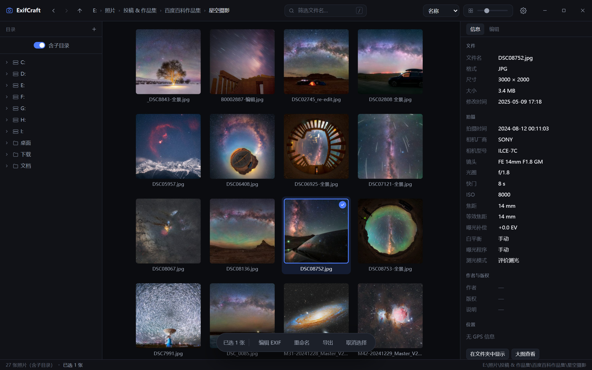
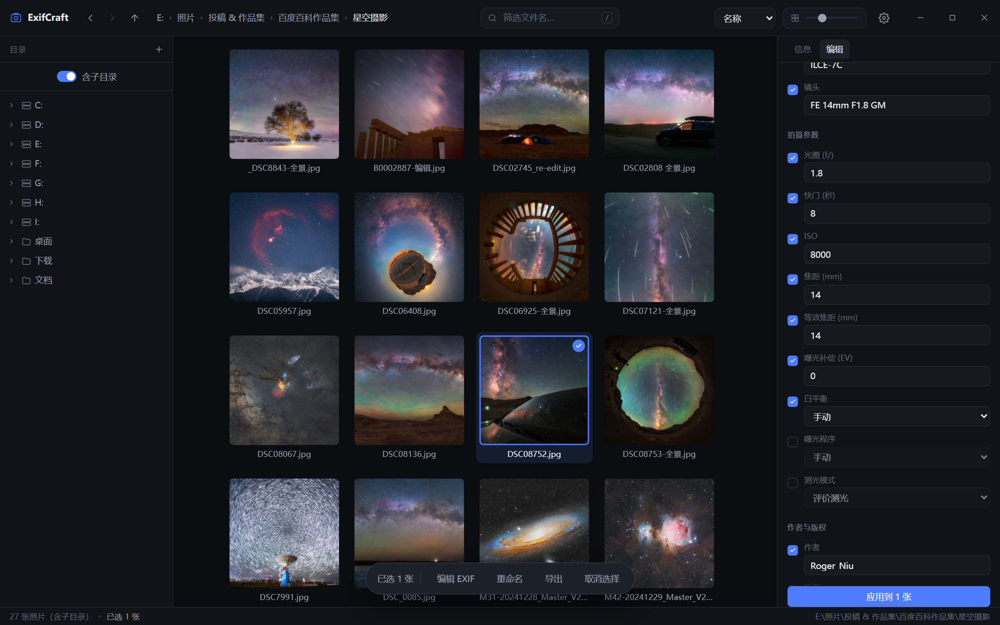
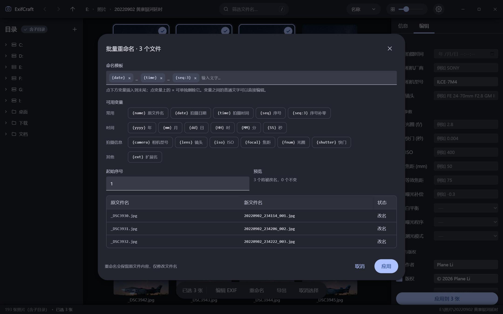
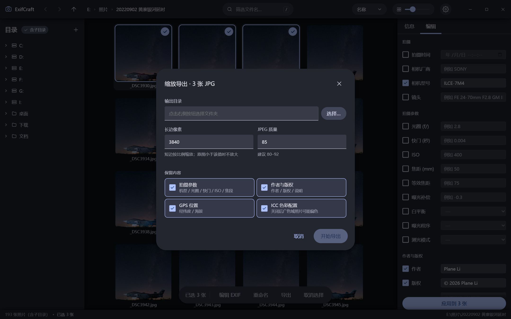
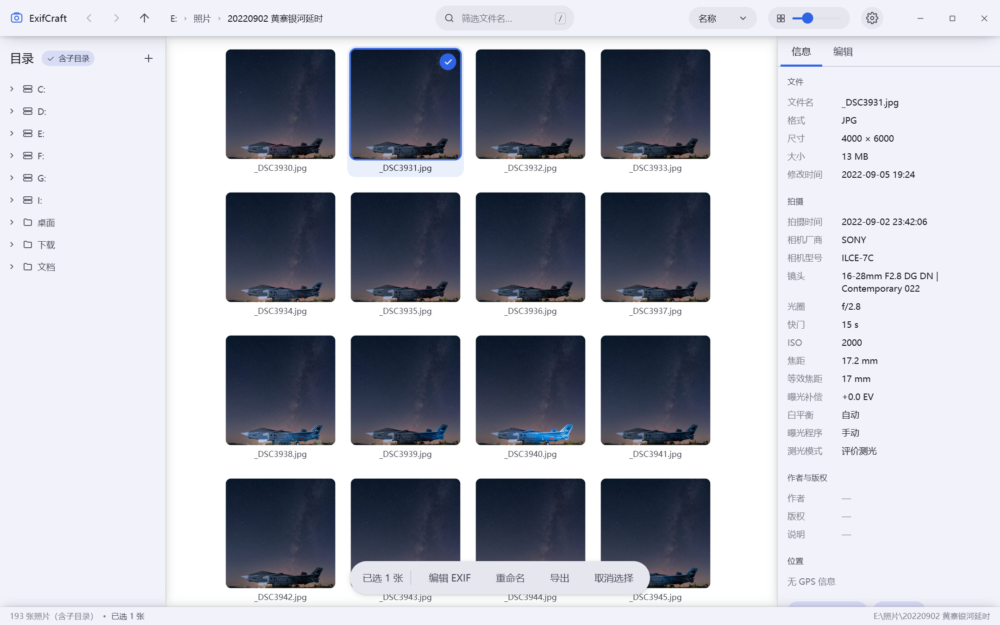
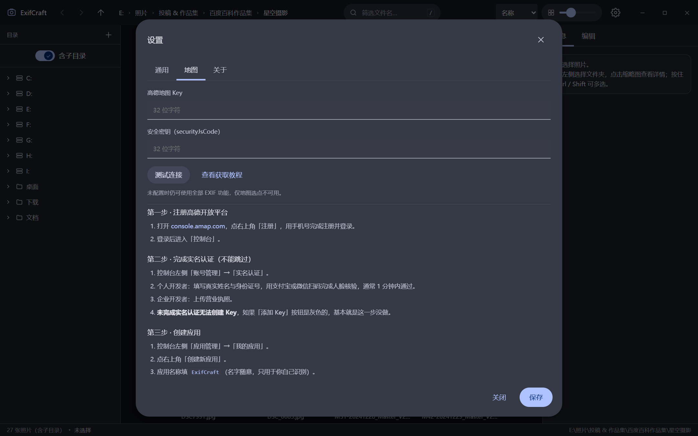

<div align="center">


# ExifCraft

**轻量的本地照片浏览与 EXIF 批量编辑工具**

不联网、不上传，所有操作都在本机完成

[](../../releases/latest)
[](../../releases/latest)
[](LICENSE)
[](../../releases/latest)

[下载](#下载) · [功能](#能做什么) · [截图](#截图) · [从源码运行](#从源码运行) · [路线图](#路线图)

</div>



## 为什么是它

- **小** — 绿色版 18.1 MB，解压即用，不写注册表；冷启动 1.5–3 秒
- **无损** — 写 EXIF 只替换 APP1 段，不重新压缩图像数据，画质零损失
- **干净** — 界面用原生 HTML/CSS/JS，无框架无构建；后端只用 Python 标准库 + Pillow + piexif + exifread；全程不联网
- **够快** — 虚拟滚动网格，上万张照片也不卡；缩略图按当前视口优先级加载，滚到哪先加载哪
- **好看** — 界面按 Material Design 3 手写（令牌、状态层、涟漪、tooltip），仍然零框架零外链，体积 +0

## 下载

到 [Releases](../../releases/latest) 页面下载 **ExifCraft-v2.1.0-win64-portable.zip**（绿色版，解压即用，无需安装）。

解压后双击 `ExifCraft.exe`。首次启动会自动创建配置目录 `%LOCALAPPDATA%\ExifCraft`：

```
config.json     设置（含高德 Key）
cache/          缩略图缓存，可随时删除
backups/        每次写入前的 EXIF 备份
```

> **系统要求**：Windows 10/11 x64，需要 [WebView2 运行时](https://developer.microsoft.com/microsoft-edge/webview2/)（Win11 与较新的 Win10 已内置）。

## 能做什么

### 看照片

- 左侧目录树浏览任意磁盘 / 文件夹，层级缩进 + 竖直引导线，深层嵌套一眼看清
- 中间缩略图网格，虚拟滚动，上万张也不卡；缩略图按**当前视口优先级**加载，滚到哪先加载哪
- 双击进入大图：缩放、拖拽、← → 切换、`I` 叠加显示 EXIF
- 「含子目录」开关：一键把整个文件夹树里的照片铺平显示
- 支持 JPG 与主流 RAW（佳能 CR3、富士 RAF、哈苏 3FR、飞思 IIQ、尼康 NEF、宾得 PEF、松下 RW2，以及 ARW / DNG / CR2 / ORF / SRW 等），RAW 直接用文件内嵌的 JPEG 预览

### 改 EXIF（只改 JPG）

- 批量修改：拍摄时间、厂商、型号、镜头、光圈、快门、ISO、焦距、等效焦距、曝光补偿、白平衡、曝光程序、测光模式、作者、版权、说明
- GPS 经纬度：手动输入，或用高德地图搜索 / 点选
- 只写入你勾选的字段，其余原样保留
- 写入前自动备份原始 EXIF，随时一键回滚

### 其他

- **批量重命名**：模板由「变量块 + 文字」拼成，每个变量带说明按钮，点 × 可单独删除；实时预览新旧对照、冲突检测、可撤销
- **缩放导出**：只导出 JPG，默认长边 3840、质量 85；拍摄参数 / 作者版权 / GPS / ICC 四项独立开关
- **左右栏可拖动**：目录栏与信息栏的宽度用鼠标拖动调整，双击恢复默认，下次启动保持

## 截图

| 批量编辑 EXIF | 批量重命名 |
|---|---|
|  |  |

| 导出设置 | 浅色主题 |
|---|---|
|  |  |

## 从源码运行

```bash
python -m venv .venv
.venv/Scripts/pip install pillow pywebview piexif exifread
.venv/Scripts/python app.py
```

可选参数：

```bash
python app.py              # 正常启动（无边框窗口）
python app.py --framed     # 用系统标题栏
python app.py --browser    # 不开窗口，只在浏览器打开
python app.py --port 18800 # 固定端口，方便调试
```

打包（产物 `dist/ExifCraft/`，约 35 MB）：

```bash
pip install pyinstaller
pyinstaller --noconfirm --clean ExifCraft.spec
```

## 快捷键

| 按键 | 作用 |
|---|---|
| 方向键 | 移动选择 |
| Shift + 方向键 | 扩展选择 |
| Ctrl + A | 全选当前视图 |
| Space | 切换选中 |
| Enter | 打开大图 / 进入文件夹 |
| `/` | 搜索文件名 |
| Esc | 取消选择 / 关闭弹层 |
| Alt + ← → ↑ | 后退 / 前进 / 上一级 |
| 大图内 `I` | 显示 EXIF 面板 |
| 大图内 `+` `-` | 放大 / 缩小 |
| `Ctrl` + 滚轮 | 调整缩略图大小 |
| `Ctrl` + `=` / `-` / `0` | 缩略图放大 / 缩小 / 复原 |
| 双击标题栏 | 最大化 / 还原 |

鼠标：Ctrl 点选、Shift 连选、空白处拖拽框选、双击看大图。

## 配置高德地图（可选）

不配置也能用全部 EXIF 功能，只是不能用地图选点。配置步骤在 **设置 → 地图 → 查看获取教程** 里有完整图文说明，要点：

1. 在 [高德开放平台](https://console.amap.com/) 注册并完成**实名认证**（不认证无法创建 Key）
2. 应用管理 → 创建应用 → 添加 Key
3. **服务平台必须选「Web端(JS API)」**（选错会报 `USERKEY_PLAT_NOMATCH`）
4. 复制 Key 和「安全密钥」两个 32 位字符串
5. 域名白名单填 `127.0.0.1`
6. 粘贴到设置页 → 点「测试连接」



**坐标说明**：EXIF 存的是 WGS-84，高德地图用 GCJ-02（火星坐标）。工具内部会自动转换，写入文件的一律是标准 WGS-84，往返误差小于 1 米。如果某张照片的坐标本身就是火星坐标（部分国产 App 会这样写），勾选编辑面板里的「这张是火星坐标」开关即可。

## 配置 ExifTool（可选，只用于读）

不配置也能用全部功能：JPG 读写、所有照片浏览、CR3 的常用 EXIF 显示都是内置实现的。ExifTool 只在你想要**更完整的 CR3 元数据**时才需要，而且它在本程序里**只读不写**，任何 RAW 都不会被修改。

1. 到 [exiftool.org](https://exiftool.org/) 下载 **Windows Executable**（形如 `exiftool-13.59_64.zip`），不要下 Perl 源码包
2. 解压得到 `exiftool-13.59_64` 文件夹，里面有 `exiftool.exe` 和 `exiftool_files`。**整个文件夹要一起留着**，exe 离开它会直接报错
3. 把整个文件夹拷到 `ExifCraft.exe` 旁边即可；也可以在 **设置 → ExifTool** 里点「选择…」指到任意位置的 `exiftool.exe`
4. 回到设置页看状态：显示版本号和「来源」（程序目录 / 设置中指定的路径）就说明接上了

程序**不会**去系统 PATH 里找 ExifTool —— 避免误用你机器上别的软件自带的那一份。没有内置它，是因为它会多占约 27 MB。

## 格式支持

| 格式 | 浏览 | 读 EXIF | 写 EXIF | 导出 |
|---|---|---|---|---|
| JPG / JPEG | ✅ | ✅ | ✅ | ✅ |
| CR3（佳能） | ✅ | ✅ | ❌ | ❌ |
| RAF（富士） | ✅ | ✅ | ❌ | ❌ |
| 3FR（哈苏） | ✅ | ✅ | ❌ | ❌ |
| IIQ（飞思） | ✅ | ✅ | ❌ | ❌ |
| NEF（尼康）/ PEF（宾得）/ RW2（松下） | ✅ | ✅ | ❌ | ❌ |
| ARW（索尼）/ DNG / CR2 / ORF / SRW 等 | ✅ | ✅ | ❌ | ❌ |

RAW 的缩略图和大图直接读取文件内嵌的 JPEG 预览，不解码原始像素，所以速度很快（30 张共 2 GB 的混品牌样片，首次生成全部缩略图约 1 秒）。**所有 RAW（CR3 / RAF / 3FR / IIQ / NEF / PEF / RW2 / ARW / DNG / CR2 / ORF …）都只读**，任何写入操作都会自动跳过 —— 这是有意的设计，不是缺失。

信息面板的「尺寸」显示**实际像素**（裁掉边缘暗角后的传感器尺寸，与 ExifTool、Lightroom 同口径），不是内嵌预览的尺寸。少数格式的内嵌图很小（飞思 IIQ 文件里只有一张 640 × 480），此时信息面板会多一行「内嵌预览 640 × 480（文件里只有这么大）」。

富士 RAF 的 EXIF 藏在文件头的内嵌 JPEG 里（exifread 直接读 RAF 容器会返回空），程序会自动取出那段 JPEG 再解析，所以不需要额外工具就能显示完整的拍摄参数。

CR3 的 EXIF 由内置的 ISO BMFF 解析器读取（拍摄时间、光圈、快门、ISO、焦距、镜头、作者、版权、GPS 等常用字段都在）。想读到更细的标签（机身序列号、镜头编号等），可以自备一份 [ExifTool](https://exiftool.org/) 放到程序目录，它**只用于读取，不参与写入**。

## 关于 EXIF 写入

写入采用**只替换 EXIF 段**的方式，不重新压缩图像数据，画质零损失，文件大小几乎不变。

**一个需要知道的限制**：重建 EXIF 段时，相机厂商私有数据（MakerNote）内部的偏移指针可能失效。这不影响任何看图软件、Lightroom、Photoshop 的正常显示，但极少数依赖 MakerNote 的镜头校正工具可能读不到原始信息。所以：

- 每次写入前都会自动备份，设置页可一键回滚
- 如果对兼容性要求极高，可以在写入后用 [ExifTool](https://exiftool.org/) 做一次只读校验（`exiftool -a -G1 文件名`）。程序不接管这条路径：**ExifTool 在本程序里只用于读取 CR3**，写入仍走 piexif 的无损段替换

## 路线图

**已确定的后续更新**

| 计划 | 说明 |
|---|---|
| ① **macOS 版** | 可复用 85–90% 代码，主要工作在打包、代码签名与公证、TCC 权限 |

**已在 2.0 完成的**

| 计划 | 说明 |
|---|---|
| ✅ **佳能 CR3 支持** | 内置 ISO BMFF 解析器读缩略图、内嵌大图预览与 EXIF；CR3 与其余 RAW 一样只读 |
| ✅ **ExifTool 可选接入** | 检测到用户自备 ExifTool 时用它把 CR3 的 EXIF 读得更完整；只读、不接管写入、不内置（体积 +0）、不查系统 PATH |

**已在 2.1 完成的**

| 计划 | 说明 |
|---|---|
| ✅ **更多品牌 RAW** | 富士 RAF、哈苏 3FR、飞思 IIQ、宾得 PEF 全部支持浏览与 EXIF；新容器的内嵌预览与真实尺寸解析都在 `core/rawimg.py` 里，零新增依赖，体积不变（仍是 62 文件 / 35 MB） |

**暂不做**

| 计划 | 说明 |
|---|---|
| RAW → JPG 导出 | 需要 rawpy，体积 +10–15 MB |

欢迎在 [Issues](../../issues) 里提需求或报 bug。

## 常见问题

**缩略图显示不出来？**
文件可能被占用，或所在磁盘已断开。尝试刷新目录（重新点一次左侧文件夹）。

**写入失败提示「RAW 文件只读，已跳过」？**
正常行为。所有 RAW（含 CR3）只读，只改 JPG。

**CR3 的 EXIF 比别的软件少几项？**
内置解析器覆盖常用字段（拍摄时间、光圈、快门、ISO、焦距、镜头、作者、版权、GPS）。富士 RAF 走文件头内嵌 JPEG 解析，字段同样完整。想更全就把一份 [ExifTool](https://exiftool.org/) 解压到 `ExifCraft.exe` 旁边，程序会自动发现它并用它读取 —— 只读，不会写入任何 RAW。

**改完时间后排序没变？**
按「修改时间」排序用的是文件系统时间，不是 EXIF 拍摄时间。切换到按名称排序，或重新进入目录。

**导出后照片发灰？**
正常情况不会。程序会保留 ICC 色彩配置；如果确实出现，检查原图是否为 CMYK 或特殊色彩空间。

**杀毒软件报毒？**
PyInstaller 打包的程序常被误报。可加入信任列表，或用源码方式运行。

**窗口没有标题栏、拖动或缩放不顺手？**
程序默认使用自绘标题栏（无边框窗口）：
- 拖动顶栏空白处移动窗口（按钮、搜索框上不会触发拖动）
- 拖动窗口八个边缘缩放
- 双击顶栏空白处最大化 / 还原

如果你的显卡驱动或远程桌面环境下出现显示异常，可以：
- 命令行运行 `ExifCraft.exe --framed`，或
- 设置 → 通用 → 勾选「使用 Windows 系统标题栏」，重启程序

**Ctrl + 滚轮没反应？**
先点一下缩略图区域让它获得焦点，再按 Ctrl 滚动。也可以在顶栏用滑块调整。

## 项目结构

```
ExifCraft/
├─ app.py                启动入口（本地服务 + WebView2 窗口）
├─ core/
│  ├─ server.py          本地 HTTP 服务，仅监听 127.0.0.1，带会话令牌
│  ├─ media.py           目录扫描、缩略图生成与缓存
│  ├─ rawimg.py          各品牌 RAW 的内嵌预览与真实尺寸提取（RAF / 3FR / NEF / PEF / RW2 / IIQ / CR3）
│  ├─ exifio.py          EXIF 读取 / 无损写入 / 备份回滚
│  ├─ ops.py             批量重命名、缩放导出、任务进度
│  ├─ coords.py          WGS-84 ↔ GCJ-02 坐标转换
│  ├─ iso_bmff.py        CR3（ISO BMFF）盒结构解析，内置，无 ExifTool 也用它
│  ├─ exiftool.py        可选的 ExifTool 检测与只读读取（不内置）
│  └─ config.py          配置与路径
├─ web/
│  ├─ index.html         界面结构 + 高德 Key 获取教程
│  ├─ style.css          Material Design 3 令牌 + 深色 / 浅色主题
│  └─ app.js             全部交互逻辑
├─ build/                应用图标
├─ assets/               README 用图
└─ screenshots/          界面截图
```

## 许可

[MIT](LICENSE) © Roger Niu

界面文案全部为简体中文，技术术语保留英文原词（EXIF / RAW / GPS / ICC）。
